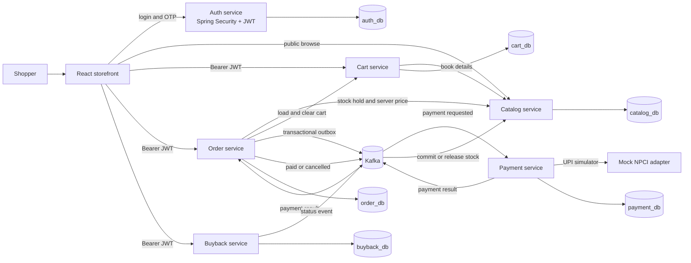
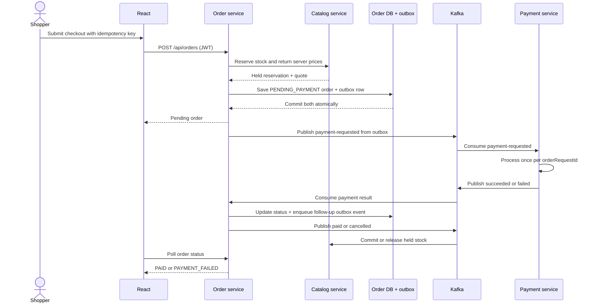

# msrbooknest architecture

## System context

The local stack runs six Java 17/Spring Boot services, the React/Vite web app, MySQL, and Kafka in KRaft mode. Each service owns its schema and persistence boundary. The schemas share one local MySQL server in Compose; they are not separate database clusters.

## Service responsibilities

| Service | Data it owns | Main responsibility |
|---|---|---|
| Auth | Users, OTP challenges, registration sessions | Verify demo registration steps, store BCrypt hashes, issue JWTs |
| Catalog | Books, inventory reservations | Search books, supply authoritative prices, hold and settle stock |
| Cart | Customer cart items | Maintain a shopper's cart and refresh book details from Catalog |
| Order | Orders, outbox events | Validate checkout, coordinate stock hold, track fulfillment/payment status |
| Payment | Payment transactions | Consume payment requests, enforce order-level idempotency, call the demo adapter |
| Buyback | Buyback cases, quote history, photos, activity, payout ledger | Manage customer/admin buyback workflow and emit status events |

`bookstore-events` contains the JSON event records and topic names shared between producer and consumer services. REST calls are used for synchronous reads and inventory reservation; Kafka carries the longer-running payment and inventory settlement workflow.

## Checkout sequence

### Consistency and failure handling

- **Price trust:** the browser sends book IDs and quantities. Catalog resolves the price; Order ignores client-supplied prices.
- **Idempotency:** a unique `orderRequestId` prevents duplicate orders. Payment stores one transaction per order ID and returns that result when Kafka redelivers a request.
- **Transactional outbox:** Order saves its state change and publishable event in the same JPA transaction. A scheduled publisher retries unsent rows; the downstream payment/catalog operations tolerate duplicate delivery.
- **Inventory compensation:** Catalog reduces available stock when it creates a hold. A paid event commits the hold; a cancelled event or 20-minute expiry releases it.
- **Currency correctness:** Java uses `BigDecimal`, request validation limits currency precision to two fraction digits, and JPA columns use `DECIMAL(12,2)`.
- **Event versioning:** event records carry `eventId`, `schemaVersion`, and `occurredAt`; topic names include `.v1`.

The workflow is eventually consistent: the browser receives a pending order first and polls for the final status. The current local project has one Kafka broker. The order outbox has retry state, while full multi-replica row claiming, a dedicated dead-letter policy, distributed tracing, and production Kafka monitoring remain sensible next steps.

## Authentication and authorization

Auth verifies BCrypt password hashes and issues an HS256 JWT with account subject, email, role, and expiry claims. Catalog, Cart, Order, Payment, and Buyback are stateless JWT resource servers. Public product browsing is allowed; shopper-specific cart/order/buyback actions require a token; catalog writes, order administration, and buyback review, inspection, return dispatch, and dispute resolution are restricted to admins.

The local registration journey stages phone OTP, email OTP, then account creation. Compose uses a demo setting that displays OTP codes in the storefront instead of delivering them. The Auth service includes MSG91 SMS and SMTP email adapters for configured environments; delivery failures return an error and OTPs are not written to logs. Demo secrets, CORS, and the shared HMAC signing key must be replaced before public hosting.

## API and operations surface

| Service | Port | Main paths | Docs / health |
|---|---:|---|---|
| Auth | 8081 | `/api/auth/register/*`, `/api/auth/login` | `/swagger-ui/index.html`, `/actuator/health` |
| Catalog | 8082 | `/api/products`, `/api/admin/products`, `/api/books/inventory/*` | same paths on port 8082 |
| Cart | 8084 | `/api/cart` | same paths on port 8084 |
| Order | 8083 | `/api/orders`, `/api/orders/me` | same paths on port 8083 |
| Payment | 8085 | `/api/payments/process`, `/api/payments/refund` | same paths on port 8085 |
| Buyback | 8086 | `/api/buybacks`, `/{id}/quote`, `/{id}/inspection`, `/{id}/dispute/resolve` | same paths on port 8086 |

Only Actuator health endpoints are exposed. Health, liveness, and readiness are public for local container/runtime checks; other Actuator endpoints are not enabled. Each service also exposes OpenAPI/Swagger documentation. There is no API gateway in the demo; the React app calls local service origins through its Nginx proxy.

## Kafka topics

| Topic | Producer → consumer | Purpose |
|---|---|---|
| `bookstore.orders.payment-requested.v1` | Order → Payment | Begin payment for a pending order |
| `bookstore.payments.succeeded.v1` | Payment → Order | Mark order paid and retain provider reference |
| `bookstore.payments.failed.v1` | Payment → Order | Mark payment failed and trigger stock release |
| `bookstore.orders.paid.v1` | Order → Catalog | Commit held inventory |
| `bookstore.orders.cancelled.v1` | Order → Catalog | Release held inventory |
| `buyback.status-events` | Buyback → consumers | Publish buyback case status changes |

## Deliberate demo boundaries

- `MockNpciGateway` is an adapter seam for the demo, not an NPCI connection. `success@upi` approves; `fail@upi` declines. No real money moves.
- Buyback video verification, courier tracking, payout, return shipping, and dispute review are simulated. Book and inspection photos persist in the local `buyback_db`; no camera, courier, NPCI, bank, or payment provider is contacted.
- Card checkout is also simulated.
- OTP codes are shown only because Compose is configured for local demo mode. Real delivery needs valid SMTP and MSG91 configuration and must disable code display.
- A single local broker and shared MySQL server make the project easy to run. Production would use resilient managed infrastructure, service credentials, migrations, monitoring, and a defined recovery policy.
